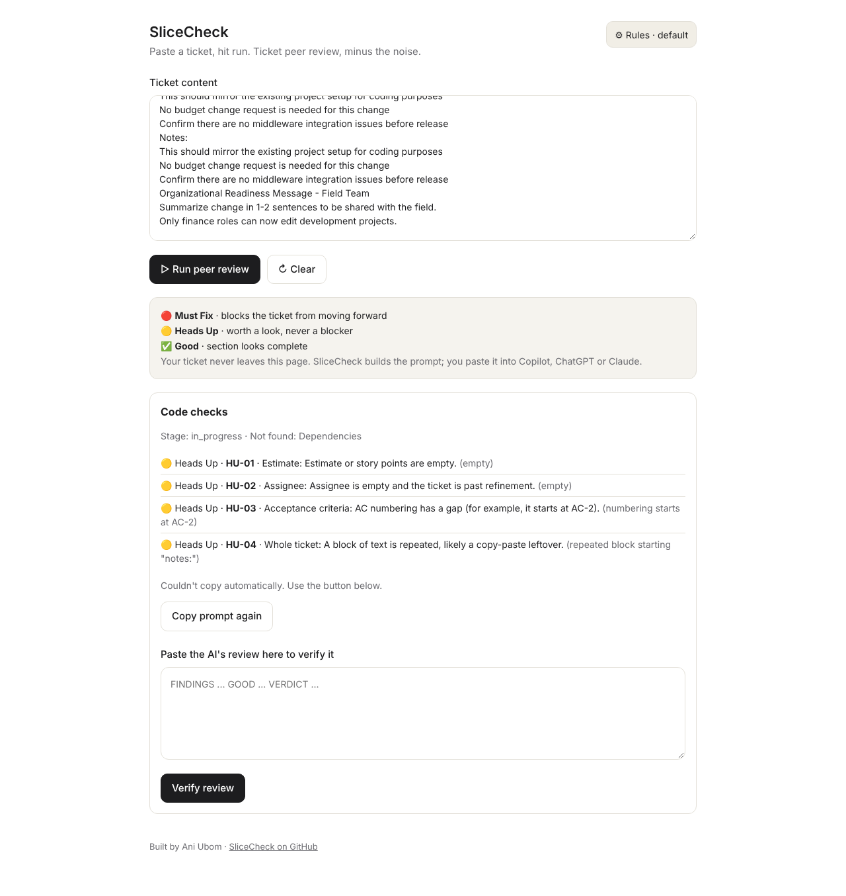
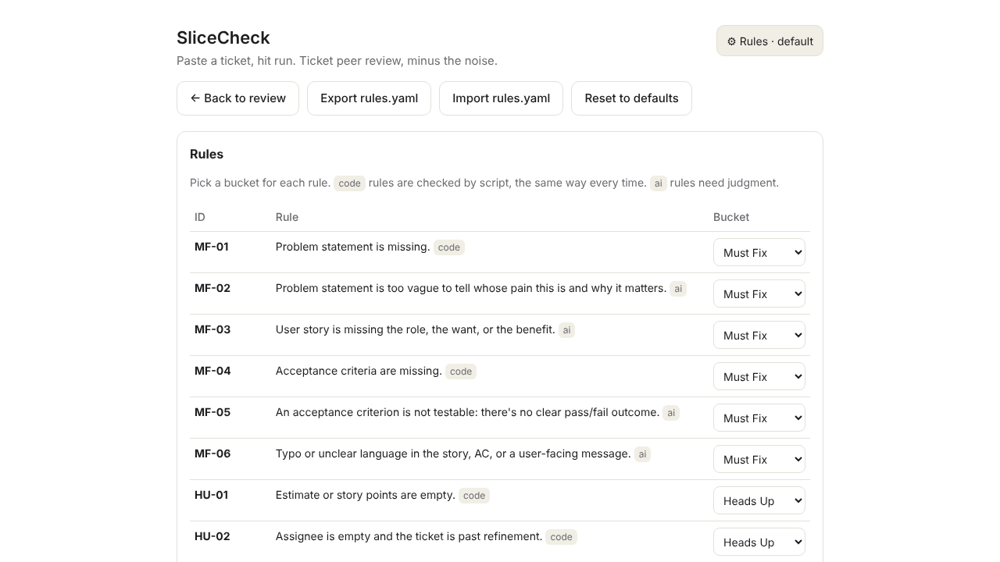

# SliceCheck

**Ticket peer review, minus the noise.**

AI peer review for requirements: user stories and acceptance criteria, sorted into **Must Fix**, **Heads Up**, and **Ignore**.



## Why it exists

I built the first version for my own team's peer reviews. We already had an AI review agent, so I tested both on the same live ticket. Theirs came back with an eight-section report, wrong findings, and advice nobody asked for. Mine came back with no false positives and a verdict you could read in five seconds. A teammate asked for my prompt that week.

The difference wasn't a smarter model. It was deciding up front what *doesn't* count as a problem. Noise is what makes people stop trusting a review tool, so in SliceCheck, **Ignore is a first-class bucket**.

## How it works

1. **Rules decide everything.** `rules.yaml` lists every rule with an ID (`MF-01`, `HU-03`, `IG-02`), a bucket, and the section it applies to.
2. **Code checks the mechanical rules.** Empty fields, placeholder dates, AC numbering gaps, copy-paste duplicates: checked by script, the same way every time.
3. **AI checks the judgment rules.** Is the problem statement clear? Are the ACs testable? Any typos or unclear language?
4. **Every review gets verified.** Each finding must cite a real rule, nothing on the Ignore list can be flagged, and the verdict has to match the findings. Any Must Fix means it can't say "Clear to proceed."

The rules travel with every review, so nothing depends on the AI remembering them.

## Three ways to use it

**1. Web tool (no install).** Paste a ticket, hit **Run peer review**. SliceCheck runs the code checks and copies a review prompt. Paste it into Copilot, ChatGPT or Claude, then paste the answer back to verify it. Your ticket never leaves the page: no server, no login, no API key.

**2. Copilot or ChatGPT only.** Paste [`copilot-prompt.md`](copilot-prompt.md) once, then paste tickets. Less exact (the AI judges every rule), but it works anywhere.

**3. Claude Code or another agent.** Clone the repo, run `npm install`, and point your agent at [`START-HERE.md`](START-HERE.md). Claude users can also install the skill in [`skills/slicecheck`](skills/slicecheck/SKILL.md).

```bash
node bin/slicecheck.mjs check  ticket.txt              # code findings
node bin/slicecheck.mjs prompt ticket.txt              # full review prompt
node bin/slicecheck.mjs verify ticket.txt review.txt   # check an AI review
```

## Make it yours

Your team has its own rules. Add them.

- **In the web tool:** open **⚙ Rules** to change any rule's bucket, add rules, rename sections ("Business Need" = Problem Statement), and set your status words. Export the result as `rules.yaml` and share it with your team.
- **In the file:** edit `rules.yaml` directly. It's plain text with comments.
- **Team pack:** optional rules many teams use (approvals, change messages, process-flow diagrams, vendor estimates) ship turned off. Switch on the ones you need.



## Default rules

| | Rule | Checked by |
|---|---|---|
| 🔴 MF-01 | Problem statement is missing | code |
| 🔴 MF-02 | Problem statement is too vague | AI |
| 🔴 MF-03 | User story is missing the role, want or benefit | AI |
| 🔴 MF-04 | Acceptance criteria are missing | code |
| 🔴 MF-05 | An acceptance criterion isn't testable | AI |
| 🔴 MF-06 | Typo or unclear language | AI |
| 🟡 HU-01 | Estimate is empty | code |
| 🟡 HU-02 | Assignee is empty past refinement | code |
| 🟡 HU-03 | AC numbering has a gap | code |
| 🟡 HU-04 | A block of text is repeated | code |
| 🟡 HU-05 | Dependency with no owner or date | AI |
| ⚪ IG-01–05 | Placeholder dates, template instruction text, optional N/A sections, empty assignee at refinement, refinement status | never flagged |

## Tested

Eight invented sample tickets in three formats (Wrike-style, Jira-style, plain) live in [`examples/`](examples/), each with expected results. `npm test` runs them, and GitHub runs them on every change.

---

Built by Ani Ubom · [aubom.online](https://aubom.online) · [LinkedIn](https://www.linkedin.com/in/aniemaubom/)
